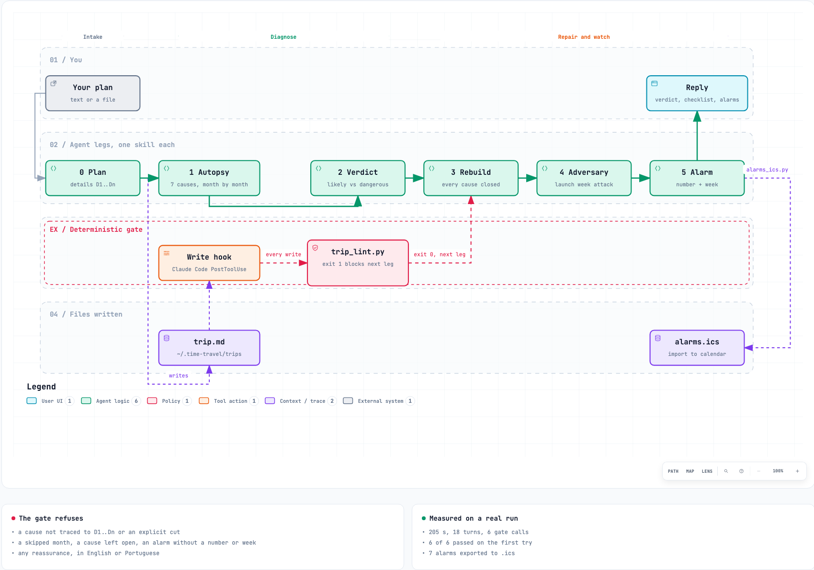

<p align="center">
  
</p>

<p align="center">
  <a href="https://github.com/Pierry/time-travel/actions/workflows/ci.yml"></a>
  <a href="https://github.com/Pierry/time-travel/releases"></a>
  
  
  
  
  
  <a href="LICENSE"></a>
</p>

**time-travel** is a premortem agent for [Claude Code](https://claude.com/claude-code) and [Codex](https://developers.openai.com/codex). You hand it a plan. It travels six months ahead, finds the plan dead, and comes back with the autopsy: what killed it, month by month, traced to the exact line of your plan that let it happen. Then it rebuilds the plan, plays your rival, and sets one measurable alarm per cause of death so you see it coming.

It never tells you the plan is great. A deterministic gate refuses the trip if it tries.

<p align="center">
  
  <br>
  <sub>Every number in this clip comes from the <a href="#a-real-run">recorded run below</a>. Full quality: <a href="docs/demo.mp4">docs/demo.mp4</a>. Source: <a href="video/">video/</a>, built with Remotion.</sub>
</p>

# Why

A premortem (Gary Klein, *Harvard Business Review*, 2007) flips the question from "will this work?" to "it failed; why?". Klein builds on research on prospective hindsight (Mitchell, Russo and Pennington, 1989): imagining that an event has already happened raised the number of reasons people found for it by 30%. Language models are polite by default, so a premortem done by asking nicely comes back as seven generic risks and a compliment. time-travel turns the method into five legs with a checklist between each, so the output is specific enough to act on.

# Install

You need Python 3.10+, `gh` logged in (the repository is private), and Claude Code, Codex or both.

```bash
gh auth login && gh auth setup-git
gh api repos/Pierry/time-travel/contents/install.sh -H "Accept: application/vnd.github.raw" | bash
```

The installer finds which CLIs you have and installs into each. Open a new session afterwards.

<details>
<summary>Install by hand, or into one host only</summary>

| Host | Install | Update |
|---|---|---|
| Claude Code | `claude plugin marketplace add Pierry/time-travel`<br>`claude plugin install time-travel@time-travel` | `claude plugin marketplace update time-travel && claude plugin update time-travel@time-travel` |
| Codex | `codex plugin marketplace add Pierry/time-travel`<br>`codex plugin add time-travel@time-travel` | `codex plugin marketplace upgrade time-travel` |
| Any other agent | clone the repository and point the agent at `AGENTS.md` | `git pull` |

Installer options: `TARGET=claude|codex|both`, `SCOPE=user|project|local` (Claude Code), `REPO=owner/name` for a fork.

</details>

# Use

In Claude Code:

```
/time-travel:premortem launch my SaaS in 8 weeks with $5k, aiming for 200 customers in 6 months
```
```
/time-travel:premortem docs/plans/q1-migration.md
```
```
premortem the plan we just discussed
```

In Codex, mention the skill or just ask:

```
$premortem I'm quitting my job in March to open a coffee shop. Savings: 9 months.
```
```
run a premortem on ROADMAP.md
```

If the plan has no goal, timeline, budget or definition of success, it asks for them once, in one message, at most three questions. Whatever you leave out is written as `not given`, and a missing answer is often cause of death number one.

## The five legs

| Leg | It asks itself | You get |
|---|---|---|
| 1. Autopsy | We are six months ahead and the plan failed. Why? | 7 causes of death, most probable first. For each: what killed it, how it happened month by month, the belief of yours that allowed it, and the first warning sign you would have seen |
| 2. Verdict | Which is most likely, which is most dangerous? | the two named and told apart, the biggest assumption you hold without noticing, and the fatal flaw said plainly, or `no:` and why |
| 3. Rebuild | What does the plan look like with every death prevented? | the rewritten plan, each change tied to the causes it closes, plus a 3 to 5 item checklist with the result that means quit for good |
| 4. Adversary | Who wins if you lose, and how would they make it happen? | the attack point, what they do in your launch week, and the blow you would never see coming |
| 5. Alarm | How do you know a cause has started? | one measurable alarm per cause: the signal, the number, and the exact week to check |

## What comes out

A reply in the conversation, one file at `~/.time-travel/trips/<date>-<slug>/trip.md`, and on request an `.ics` with the alarms. The next section is a real run, not a mock up.

# A real run

One command on a four line plan, recorded end to end on 2026-10-25 and committed as is in [`examples/invoice-nudge/`](examples/invoice-nudge/). How it was recorded, and the two local paths that were blanked: [`run.md`](examples/invoice-nudge/run.md).

| | |
|---|---|
| Input | [`plan.md`](examples/invoice-nudge/plan.md), a SaaS that chases late invoices: $29/month, solo founder, $5,000, MVP in 6 weeks, 200 customers in 6 months |
| Command | `/time-travel:premortem plan.md` |
| Model | `claude-opus-5-5` through Claude Code |
| Time | 205 s, 18 turns |
| Gate | 6 calls, 6 `trip_lint: ok` on the first try, no repair |
| Output | [`reply.md`](examples/invoice-nudge/reply.md), [`trip.md`](examples/invoice-nudge/trip.md) (208 lines), [`alarms.ics`](examples/invoice-nudge/alarms.ics) (7 events) |

## The reply, first lines verbatim

> Arrival is 2027-04-25. The most likely way Nudge dies is a single launch spike with nothing after it. Product Hunt, 1,800 followers and an r/freelance post bring one week of trials in the week before Christmas, and nothing in the plan brings a second week. By April that leaves about 17 paying customers against the target of 200.
>
> **Fatal flaw:** yes. The distribution as written can't reach the goal.
> - 200 paying customers at a typical 10–15% trial-to-paid rate means roughly 1,300–2,000 trials.
> - At 2–4% of visitors starting a trial, that means 30,000–100,000 visitors.
> - Your three channels plus $2,000 of ads deliver perhaps 5,000–10,000. These are typical ranges for this kind of launch, not measurements, but the goal is off by a factor of five to ten.

Note what it found that the plan never says: launch week 8 falls on 2026-12-20, the week before Christmas.

## Leg 1, one of the seven causes, from `trip.md`

Shortened here: months 1, 4 and 5 and the tail of month 3 are cut; the file has all six.

```markdown
### Cause 1: One launch spike, then silence

- Likelihood: 60%
- Killed by: Product Hunt, 1,800 Twitter followers and an r/freelance post produced a single
  week of traffic in the week before Christmas, and nothing in the plan generated a second week.
- Traces to: D8, D9, D11
- Premise: "If the product is good, a Product Hunt launch and my followers will get the first
  wave, and word of mouth does the rest."
- First warning sign: in launch week, under 1,500 site visitors and under 40 trial signups;
  the r/freelance post removed within hours as self-promotion.

| Month | What happened |
|---|---|
| 2 | Launch on 2026-12-20, the week before Christmas. Product Hunt gives about 1,100 visitors
      and 35 trials; Twitter drives 200 clicks; the r/freelance post is removed by the moderators. |
| 3 | January. Daily signups fall from 8 to under 1 by mid-month. 6 of the 35 trials convert. |
| 6 | April 2027. 17 paying customers against the 200 the plan needs. The plan is declared dead. |
```

The other six: two integrations ate the six weeks (50%), late invoices are episodic while the subscription is monthly (45%), the free reminder already inside Stripe and QuickBooks (40%), $2,000 of ads bought 20 customers (35%), money and founder ran out first (30%), a final notice hurt a client and r/freelance heard (20%).

## Leg 2, the verdict

```markdown
- Most likely: Cause 1, one launch spike, then silence
- Most dangerous: Cause 7, a final notice hurt a client relationship, and r/freelance heard about it
- Hidden assumption: that late invoices are a frequent, monthly pain freelancers will pay $29 a
  month to hand to a robot that speaks to their clients. Causes 1, 3, 4 and 7 all rest on it.
```

## Leg 3, the checklist before writing any code

| Confirm | Quit if |
|---|---|
| By week 3: interview 20 freelancers about how many invoices went late in the last 90 days | Fewer than 6 of 20 had 2 or more late invoices |
| By week 4: sell a hand-run month of invoice chasing at $29, paid up front | Fewer than 5 people pay |
| By week 4: show each payer the free reminders in their Stripe or QuickBooks next to Nudge | 3 or more of the first 5 say the free one is enough |
| By week 12, before the public launch: count waitlist emails | Fewer than 150 |
| During the hand-run month: count how often payers approve the escalation emails | Fewer than half get approved, or 2 of 5 payers refuse any email to their client |

The rebuilt plan also moves the launch to 2027-01-17, cuts the MVP to one integration, and resets the six month goal to 60 paying customers with 200 as the 12 month goal.

## Leg 4, the adversary

> Blind side: I would not attack the product; I would attack the funnel. The free escalation templates Nudge gives away as its lead magnet are the asset that ranks in search after launch. I republish an expanded version within two weeks.

## Leg 5, the alarms

| Cause | Signal | Threshold | Check week |
|---|---|---|---|
| Cause 4 | concierge payers: "would keep Nudge" against "free reminder is enough" | 3 or more of the first 5 say the free reminder is enough | Week 4 |
| Cause 2 | a real overdue invoice synced end to end into Nudge | 0 real invoices synced by the end of week 7 | Week 7 |
| Cause 1 | waitlist confirmed emails, counted every Friday | fewer than 75 by week 8 | Week 8 |
| Cause 6 | bank statement against Stripe MRR | more than $2,500 spent while MRR is under $300 | Week 14 |

Plus three more in the file. `alarms.ics` puts all seven on a calendar.

## Put the alarms on your calendar

```bash
python3 ~/.claude/plugins/marketplaces/time-travel/scripts/alarms_ics.py \
  --artifact ~/.time-travel/trips/2026-10-25-invoice-nudge/trip.md --out alarms.ics
```

One all day event per alarm on its check week, with the signal and the threshold in the description and a 09:00 reminder. Import the file into Google Calendar, Apple Calendar or Outlook. The agent prints this command with the right paths at the end of every trip; it never writes to your calendar itself.

# What the gate guarantees

`sensors/trip_lint.py` runs after every leg (in Claude Code, a hook runs it on every write of a trip file). It is plain Python, no model involved, and it refuses the trip when:

- there are not exactly 7 causes, or a later cause is more likely than an earlier one
- a cause does not trace to a numbered detail of your plan (`D3`) or to an explicit `cut:` naming what the plan left out
- a cause skips a month of its six month timeline, or has no premise or warning sign
- the verdict calls "most likely" a cause that the autopsy rated lower than another
- the fatal flaw is not a plain `yes:` or `no:`
- any of the 7 causes is left open by the rebuilt plan, or the checklist has fewer than 3 or more than 5 items, or an item has no quit condition
- an alarm has no number in its threshold, or no exact week inside the six months
- the file reassures you: "don't worry", "great plan", "you'll be fine", "good luck", and their Portuguese twins

Every rule has a test that must catch the broken case and one that must let the clean case through.

# How it works

<p align="center">
  <a href="docs/diagrams/pipeline.html"></a>
  <br>
  <sub>Built with Archify from <a href="docs/diagrams/pipeline.workflow.json">pipeline.workflow.json</a>. Open <a href="docs/diagrams/pipeline.html">pipeline.html</a> locally for the interactive version (pan, zoom, trace).</sub>
</p>

| Piece | Claude Code | Codex | Other agents |
|---|---|---|---|
| `skills/*/SKILL.md` | plugin skills, `/time-travel:<leg>` | plugin skills, `$<leg>` | read as files |
| `agents/time-travel.md` | sub-agent `time-travel` | read by the `premortem` skill | read as a file |
| `sensors/trip_lint.py` | run by the skills and by a PostToolUse hook | run by the skills | `AGENTS.md` says when |
| `templates/trip.md` | the trip skeleton | same | same |
| `scripts/alarms_ics.py` | calendar export | same | same |

```
.claude-plugin/        Claude Code plugin and marketplace manifests
.codex-plugin/         Codex plugin manifest
.agents/plugins/       Codex marketplace manifest
agents/                the persona, limits and closing reply
skills/                premortem (entry point) and one skill per leg
templates/trip.md      the artifact every trip fills
sensors/               the gate, the repository lint, their tests and the test fixture
scripts/               the calendar export and its tests
hooks/                 the Claude Code hook that gates every trip write
examples/              a recorded real run: plan, reply, trip and alarms.ics
docs/                  banner, logo, demo clip and the Archify pipeline diagram
video/                 the Remotion source of the demo clip (npm install && npm run render)
```

# Configuration

| Variable | Default | Effect |
|---|---|---|
| `TIME_TRAVEL_HOME` | `~/.time-travel` | where trips are written |
| `TIME_TRAVEL_GATE` | `on` | `off` disables the Claude Code write hook (the skills still run the gate) |

# Development

```bash
python3 sensors/repo_lint.py          # structure, versions, badges, house style
python3 sensors/test_sensors.py       # 68 cases, every gate rule both ways
python3 scripts/test_alarms_ics.py    # 11 cases, the calendar export
claude --plugin-dir .                 # try the plugin from a working copy
```

No dependencies beyond the standard library.

## Releases

Every merge to `main` that changes the plugin ships a release:

1. Bump `version` in `.claude-plugin/plugin.json`, `.claude-plugin/marketplace.json` and `.codex-plugin/plugin.json`, and add a `## [x.y.z]` entry to `CHANGELOG.md`.
2. Open a PR. CI runs the lint, the tests and the gate on Python 3.10 and 3.14, and refuses a PR that changes plugin files without a higher version.
3. Merge. The release workflow runs the gate again, creates the tag `vx.y.z`, publishes a GitHub release with the changelog entry as notes, and moves the major tag (`v0`, `v1`).

Changes to docs, the README or CI alone release nothing.

# Credits

The premortem is Gary Klein's ("Performing a Project Premortem", *Harvard Business Review*, September 2007). The five prompts this agent is built around (the autopsy, the verdict, the reconstruction, the adversary and the alarm) come from a widely shared prompt series on running a premortem with an AI. The artifact and gate pattern come from the Forja and Nenya agents.

MIT licensed. See [LICENSE](LICENSE).
