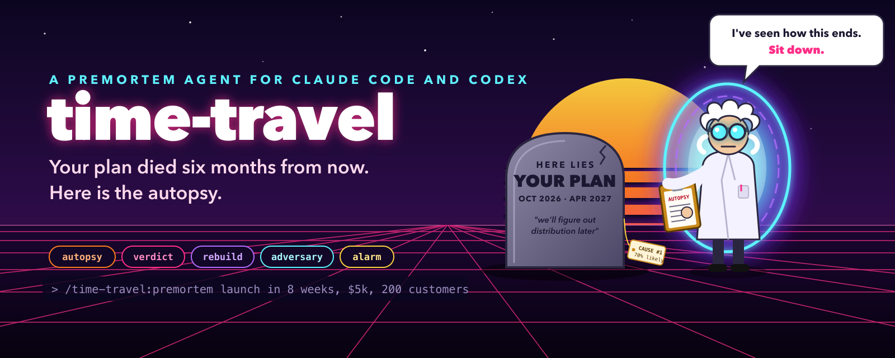
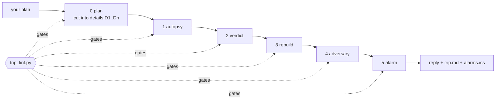

<p align="center">
  
</p>

<p align="center">
  <a href="https://github.com/Pierry/time-travel/actions/workflows/ci.yml"></a>
  <a href="https://github.com/Pierry/time-travel/releases"></a>
  
  
  
  
  
  <a href="LICENSE"></a>
</p>

**time-travel** is a premortem agent for [Claude Code](https://claude.com/claude-code) and [Codex](https://developers.openai.com/codex). You hand it a plan. It travels six months ahead, finds the plan dead, and comes back with the autopsy: what killed it, month by month, traced to the exact line of your plan that let it happen. Then it rebuilds the plan, plays your rival, and sets one measurable alarm per cause of death so you see it coming.

It never tells you the plan is great. A deterministic gate refuses the trip if it tries.

# Why

A premortem (Gary Klein, *Harvard Business Review*, 2007) flips the question from "will this work?" to "it failed; why?". Klein builds on research on prospective hindsight (Mitchell, Russo and Pennington, 1989): imagining that an event has already happened raised the number of reasons people found for it by 30%. Language models are polite by default, so a premortem done by asking nicely comes back as seven generic risks and a compliment. time-travel turns the method into five legs with a checklist between each, so the output is specific enough to act on.

# Install

You need Python 3.10+, `gh` logged in (the repository is private), and Claude Code, Codex or both.

```bash
gh auth login && gh auth setup-git
gh api repos/Pierry/time-travel/contents/install.sh -H "Accept: application/vnd.github.raw" | bash
```

The installer finds which CLIs you have and installs into each. Open a new session afterwards.

<details>
<summary>Install by hand, or into one host only</summary>

| Host | Install | Update |
|---|---|---|
| Claude Code | `claude plugin marketplace add Pierry/time-travel`<br>`claude plugin install time-travel@time-travel` | `claude plugin marketplace update time-travel && claude plugin update time-travel@time-travel` |
| Codex | `codex plugin marketplace add Pierry/time-travel`<br>`codex plugin add time-travel@time-travel` | `codex plugin marketplace upgrade time-travel` |
| Any other agent | clone the repository and point the agent at `AGENTS.md` | `git pull` |

Installer options: `TARGET=claude|codex|both`, `SCOPE=user|project|local` (Claude Code), `REPO=owner/name` for a fork.

</details>

# Use

In Claude Code:

```
/time-travel:premortem launch my SaaS in 8 weeks with $5k, aiming for 200 customers in 6 months
```
```
/time-travel:premortem docs/plans/q1-migration.md
```
```
premortem the plan we just discussed
```

In Codex, mention the skill or just ask:

```
$premortem I'm quitting my job in March to open a coffee shop. Savings: 9 months.
```
```
run a premortem on ROADMAP.md
```

If the plan has no goal, timeline, budget or definition of success, it asks for them once, in one message, at most three questions. Whatever you leave out is written as `not given`, and a missing answer is often cause of death number one.

## The five legs

| Leg | It asks itself | You get |
|---|---|---|
| 1. Autopsy | We are six months ahead and the plan failed. Why? | 7 causes of death, most probable first. For each: what killed it, how it happened month by month, the belief of yours that allowed it, and the first warning sign you would have seen |
| 2. Verdict | Which is most likely, which is most dangerous? | the two named and told apart, the biggest assumption you hold without noticing, and the fatal flaw said plainly, or `no:` and why |
| 3. Rebuild | What does the plan look like with every death prevented? | the rewritten plan, each change tied to the causes it closes, plus a 3 to 5 item checklist with the result that means quit for good |
| 4. Adversary | Who wins if you lose, and how would they make it happen? | the attack point, what they do in your launch week, and the blow you would never see coming |
| 5. Alarm | How do you know a cause has started? | one measurable alarm per cause: the signal, the number, and the exact week to check |

## What comes out

A reply in the conversation and one file, `~/.time-travel/trips/<date>-<slug>/trip.md`. A full worked trip lives in [`examples/invoice-nudge/trip.md`](examples/invoice-nudge/trip.md), made from [this plan](examples/invoice-nudge/plan.md). An excerpt:

```markdown
### Cause 2: Nobody trusts a robot to email their client about money

- Likelihood: 55%
- Killed by: freelancers read the first AI draft and switch auto-send off, because one
  wrong tone costs them a client worth far more than $29
- Traces to: D7
- Premise: freelancers hate chasing invoices so much they will delegate the relationship
- First warning sign: under 30% of trials leave auto-send on after the first draft
```

```markdown
## 2. Verdict

- Most likely: Cause 1, the launch spike that never became a pipeline
- Most dangerous: Cause 2, nobody trusts a robot to email their client about money
- Fatal flaw: yes: auto-sending AI emails to the client is both the differentiator and
  the reason to churn; the plan grows a product whose main feature users disable
```

```markdown
| Confirm                                                         | Quit if                                   |
|-----------------------------------------------------------------|-------------------------------------------|
| Show 15 freelancers an AI draft for their own late invoice      | fewer than 5 would send it with no edit   |
| Pre-sell 3 months for $60 to the waitlist before building       | fewer than 10 people pay                  |
```

```markdown
| Cause   | Signal                                    | Threshold              | Check week |
|---------|-------------------------------------------|------------------------|------------|
| Cause 2 | share of drafts sent with no edit         | under 30% of drafts    | Week 9     |
| Cause 5 | QuickBooks production keys approved       | not approved by week 4 | Week 4     |
```

## Put the alarms on your calendar

```bash
python3 ~/.claude/plugins/marketplaces/time-travel/scripts/alarms_ics.py \
  --artifact ~/.time-travel/trips/2026-10-25-invoice-nudge/trip.md --out alarms.ics
```

One all day event per alarm on its check week, with the signal and the threshold in the description and a 09:00 reminder. Import the file into Google Calendar, Apple Calendar or Outlook. The agent prints this command with the right paths at the end of every trip; it never writes to your calendar itself.

# What the gate guarantees

`sensors/trip_lint.py` runs after every leg (in Claude Code, a hook runs it on every write of a trip file). It is plain Python, no model involved, and it refuses the trip when:

- there are not exactly 7 causes, or a later cause is more likely than an earlier one
- a cause does not trace to a numbered detail of your plan (`D3`) or to an explicit `cut:` naming what the plan left out
- a cause skips a month of its six month timeline, or has no premise or warning sign
- the verdict calls "most likely" a cause that the autopsy rated lower than another
- the fatal flaw is not a plain `yes:` or `no:`
- any of the 7 causes is left open by the rebuilt plan, or the checklist has fewer than 3 or more than 5 items, or an item has no quit condition
- an alarm has no number in its threshold, or no exact week inside the six months
- the file reassures you: "don't worry", "great plan", "you'll be fine", "good luck", and their Portuguese twins

Every rule has a test that must catch the broken case and one that must let the clean case through.

# How it works



| Piece | Claude Code | Codex | Other agents |
|---|---|---|---|
| `skills/*/SKILL.md` | plugin skills, `/time-travel:<leg>` | plugin skills, `$<leg>` | read as files |
| `agents/time-travel.md` | sub-agent `time-travel` | read by the `premortem` skill | read as a file |
| `sensors/trip_lint.py` | run by the skills and by a PostToolUse hook | run by the skills | `AGENTS.md` says when |
| `templates/trip.md` | the trip skeleton | same | same |
| `scripts/alarms_ics.py` | calendar export | same | same |

```
.claude-plugin/        Claude Code plugin and marketplace manifests
.codex-plugin/         Codex plugin manifest
.agents/plugins/       Codex marketplace manifest
agents/                the persona, limits and closing reply
skills/                premortem (entry point) and one skill per leg
templates/trip.md      the artifact every trip fills
sensors/               the gate, the repository lint and their tests
scripts/               the calendar export and its tests
hooks/                 the Claude Code hook that gates every trip write
examples/              a full plan and its trip, also the test fixture
```

# Configuration

| Variable | Default | Effect |
|---|---|---|
| `TIME_TRAVEL_HOME` | `~/.time-travel` | where trips are written |
| `TIME_TRAVEL_GATE` | `on` | `off` disables the Claude Code write hook (the skills still run the gate) |

# Development

```bash
python3 sensors/repo_lint.py          # structure, versions, badges, house style
python3 sensors/test_sensors.py       # 68 cases, every gate rule both ways
python3 scripts/test_alarms_ics.py    # 11 cases, the calendar export
claude --plugin-dir .                 # try the plugin from a working copy
```

No dependencies beyond the standard library.

## Releases

Every merge to `main` that changes the plugin ships a release:

1. Bump `version` in `.claude-plugin/plugin.json`, `.claude-plugin/marketplace.json` and `.codex-plugin/plugin.json`, and add a `## [x.y.z]` entry to `CHANGELOG.md`.
2. Open a PR. CI runs the lint, the tests and the gate on Python 3.10 and 3.14, and refuses a PR that changes plugin files without a higher version.
3. Merge. The release workflow runs the gate again, creates the tag `vx.y.z`, publishes a GitHub release with the changelog entry as notes, and moves the major tag (`v0`, `v1`).

Changes to docs, the README or CI alone release nothing.

# Credits

The premortem is Gary Klein's ("Performing a Project Premortem", *Harvard Business Review*, September 2007). The five prompts this agent is built around (the autopsy, the verdict, the reconstruction, the adversary and the alarm) come from a widely shared prompt series on running a premortem with an AI. The artifact and gate pattern come from the Forja and Nenya agents.

MIT licensed. See [LICENSE](LICENSE).
